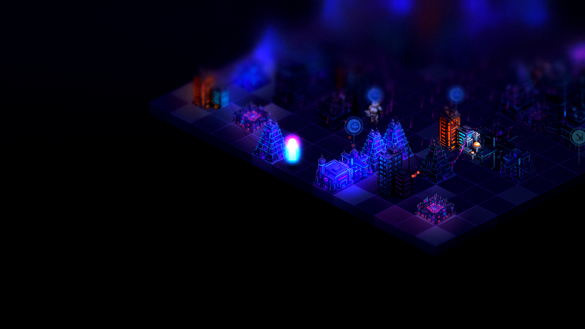
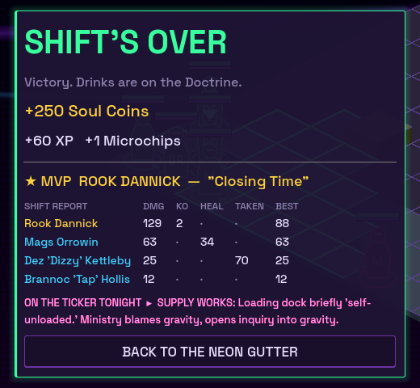
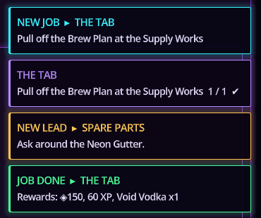
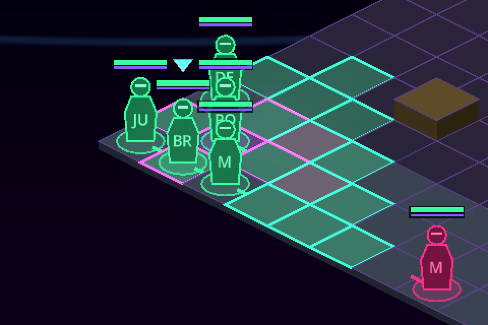
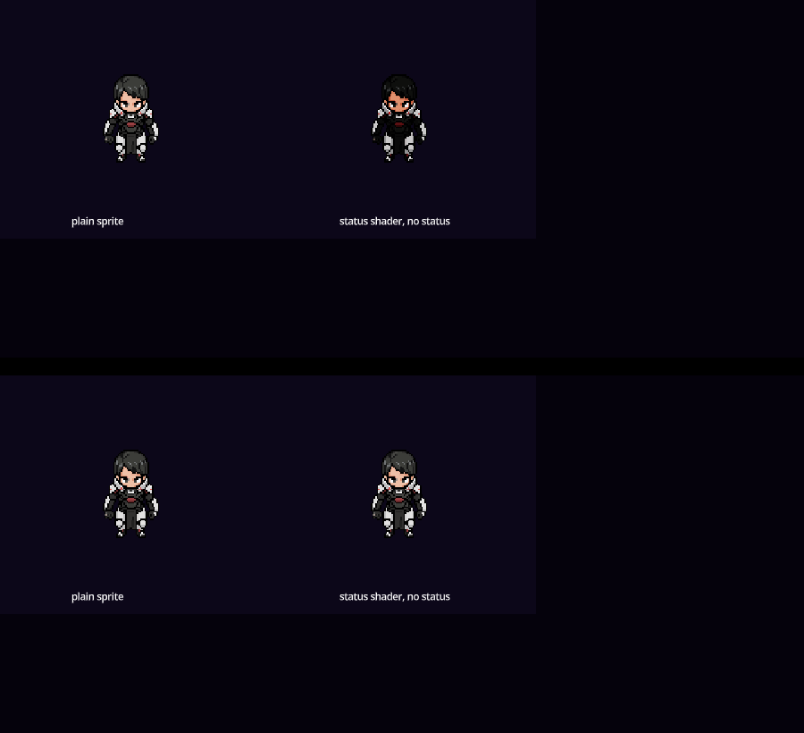
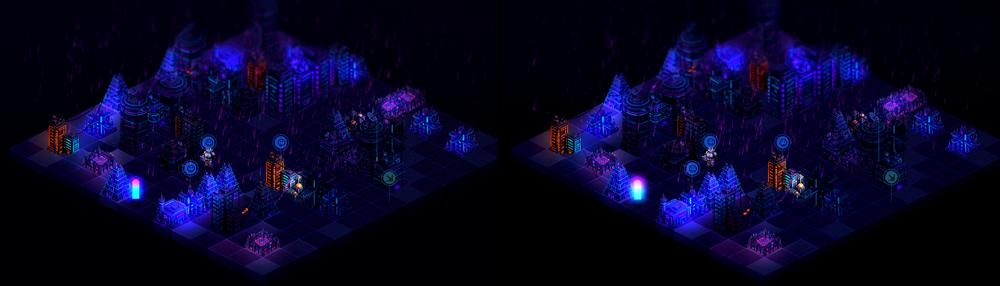

# While you were at work (Oct 15)

All pushed to `claude/optimistic-fermat-pie49w`. Tests: 644 + 495 passing, every script compiles.

## New things to try
- **Photo mode**: press **P** in the streets or in a battle. Hides the HUD and gives you a free camera (WASD / right-drag, wheel or Q E to zoom). Click to set the tilt-shift focus line, `[ ]` for blur, `- =` for the sharp band, `1` to cycle looks (neon_noir, cinematic, dream…), `F` to freeze time, Enter or F12 to save. **O** opens the folder. Closing it puts everything back exactly. 
- **Shift Report**: the results screen shows who carried the fight, with an MVP and a title they earned ("Closing Time", "Designated Driver", "Human Sandbag"…). 
- **News Reacts**: the Doctrine news desk spins every battle onto the ticker and the living screens. Wins become "scheduled maintenance", losses become gloating, bosses go "on extended leave", MVPs get wanted posters, and sometimes Kade Halloway's Veil feed chimes in. Lines live in `data/news_reacts.json`, so add your own.
- **Quest toasts**: NEW JOB / NEW LEAD / progress / JOB DONE cards on every screen. 
- **STREETS** tab in the hub: the in-game way out of the bar onto the street maps.
- **Settings** (hub → SAVE / QUIT): fast battles (1.6×), reduce motion, barks, sound effects + volume, auto Sync Additions. They're saved between sessions.
- **Charged spells are marked on the map**: violet outline for enemy casts, cyan for yours. The AI now steps out of them. 

## Visual fixes (improvements only, before → after)
- Units no longer get darker and warmer after their first status effect (a shader bug). 
- The streets get the same neon glow as battles (left before, right after). 

## Fixed from Grok's list
Hit-stop/slow-mo now has one owner of game speed. The explore backdrop is no longer a 60,000-pixel rectangle. Mission AI overrides and guest statuses apply. Steal abilities pay out at the end of the battle. Loot anchors and street loot count for find-loot quests. Rumours can wait for story flags (`required_flag`, `hidden_flag`). Foreman Grisk is a proper boss. The vault relay no longer plays "shield down" twice. Painted tiles survive into battle exactly (a bridge over water stays walkable). Passives are editable in the Forge. Long PixelLab folder names are shortened so Windows can pull them.

Already fine, no change needed: hidden, blinded, focused, berserk, identity loss and dualcast all work (Grok's note was out of date).

## Your call (not changed)
1. **Enemies use both action points?** The AI takes one action a turn while your units take two. Giving them both makes every fight much harder.
2. **Sleep breaks when hit?** FFT does it; ours doesn't.
3. **Mission difficulty slider:** `difficulty_modifier` exists but nothing reads it. Should it scale enemy HP, damage, levels, or the AI?
4. **Losing a street battle:** back to the map at 1 HP, game over and reload, or back to the hub (current behavior)?
5. **Knocked-out crew get XP?** Right now they do.
6. **Anchor-only turns:** using a terminal without attacking costs less turn time. Intended discount?
7. **Facings:** cardinal in code vs. diagonal in art and the roadmap.
8. **Fog sheet:** it has the same texture-squared quirk as the status shader. Fixing it would make all fog about twice as thick, so I left it.
