# While you were at work (Nov 13)

All pushed to `claude/optimistic-fermat-pie49w`. Nothing was wired into abilities, items or characters yet; this is art plus tools.

## Credits
The balance went from **6,091.45 to 5,601.45, a 490 drop** (that includes anything you generated in PixelLab meanwhile).
- Pistol back views: 54 (2 for the A/B test, 49 for the batch, 3 redos).
- The four outfits: about 436, including 6 redo facings (about 18). Every take is kept; nothing was deleted.

## Pistols: real NW/NE views for all 49 (method B)
PixelLab drew each pistol's NW (back) view from your SW drawing; NE is its mirror. Barrel axis and grip were refitted per view in `attach.json`. The game folders now use them.
- Contact sheet: `assets/gear/source/pistol_rotations/all_49_SW_vs_NW.png`.
- In-hand sample: `assets/gear/source/pistol_rotations/in_hand_sample.png`.

## The four new outfits: all 9 clips x 4 facings
Street samurai (`samurai`), scrap tinkerer (`tinkerer`), jumpjet dragoon with helmet (`dragoon_helm`) and new char 01 (`neon_coat`).
- Clips: walk, hit, death, jump, use_item, throw, pistol, rifle rest and rifle raise. They are all on the same base poses as the first six, so slots mix.
- Back-facing rifles are steadied like the others. Every clip passed an automatic check (frames, edges, colours) and my look at a sheet against the standing art.
- Folders: `assets/units/base_male_hi/source/<unit>_<clip>_<facing>[_clean]`.
- GIFs: `docs/screenshots/outfits_r2/`.

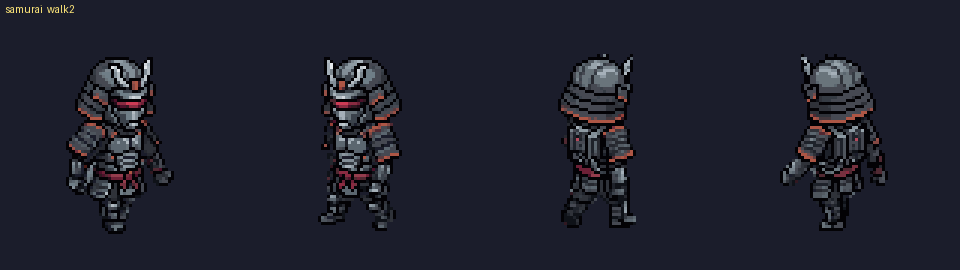
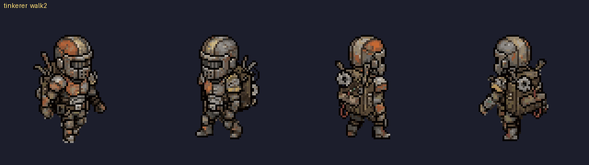
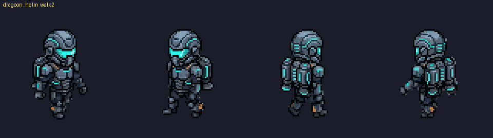
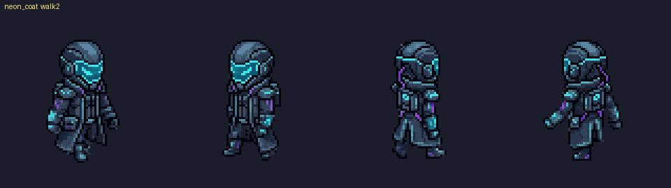

## Grenades and land mines cut from your sheet
14 grenades and 14 mines are in `assets/gear/throwables/<grenade|mine>_NN/`.
- `item.png` has no drop shadow; it's for the hand, the flight and the icon.
- Mines also get `ground.png` plus a `ground_anchor` (the tile point) for placing them. Your mines have no drop shadow, so the game should draw one.
- Row 3 col 6 (a rocket), row 4 col 6 (a holo shield) and row 4 col 7 (a terminal) came in as "mines" because they sit in those rows. Rename or drop them as you like.

## What I couldn't fix (for when you're home)
- **Use_item and throw, all units:** on the frames where the arm is up by the head, it turns into a darker, less detailed smear.
  - The six approved units have it too, so it's how PixelLab draws that pose. The samurai shows it most.
  - Its use_item got 2 redos per facing, including one with "plated sleeves" in the prompt. That didn't really help; the best take of each is in use, and all are kept.
  - Ideas: paint the sleeve from the walk frames, or pose the hand lower.
- **Pistols #3 and #8:** the back view comes out boxy, like a brick, after 2 redos. 3 takes of each are kept; the game uses the latest. #19's holo screen was fixed by a new seed.
- Minor, kept as is:
  - Samurai hit NE: the helmet horn shrinks on frames 2-3.
  - Tinkerer walk: the rust shimmers, and the SW frame 6 legs smear.
  - Neon_coat walk: the purple trim comes and goes on some SE frames.
  - Dragoon_helm walk: SE frame 7 visor taller, SW frame 6 rough.
  - Dragoon_helm death NE/NW: lying down, it turns into a rounder blob and the jetpack disappears.
  - Neon_coat jump NW: the helmet darkens on the last frame.
  - Dragoon_helm rifle raise SE: the visor dims on frame 7.
- To check: tinkerer death SE/NE hides the backpack once he's on his back.
- Fixed in place: the neon_coat SE rifle raise frame 3 had a ghost hand floating beside it, now removed (note in its folder). The tinkerer jump NW had a smeared frame; the redo fixed it.

## Next (your call)
1. **Helmets as head pieces:** cut the four helmets out of these outfits so they ride any body, then recolours (free).
2. **The 49 pistols as items:** add them to `data/items.json`, or will you set their stats in the Forge?
3. **Wiring the grenades and mines in:** thrown flight sprites, and mines placed on tiles. That changes the look, so I'll show before/after first.
4. **Buildings over 8192 px:** waiting for your new buildings.

# While you were at work (Nov 6)

All pushed to `claude/optimistic-fermat-pie49w`; the verify gate passed on every push.

## Your 25 characters are animated and in the game
Walk, attack, hurt, death and jump in all 4 battle facings (front facings by PixelLab template, back facings by skeleton-v3, your pick B). #19, #25, #79 and #97 look the same flipped, so they're drawn SE + NE and mirrored. Idle uses their 8 standing poses, and cast falls back to attack. Each one is in `assets/units/pool_<n>/` with free hand / elbow / head points from PixelLab's stored skeletons.

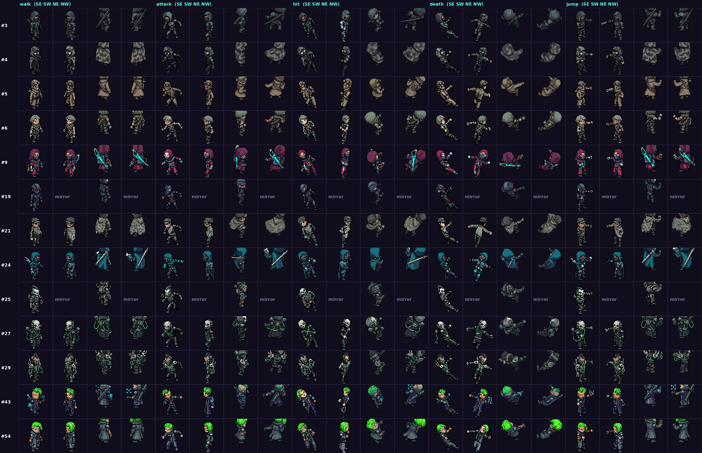
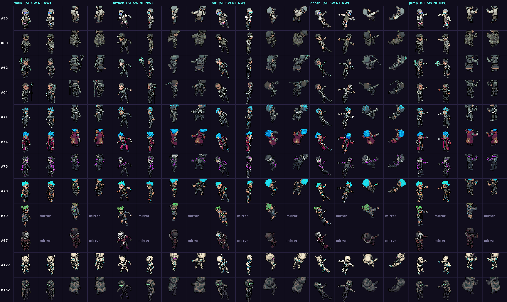

- **Credits:** the balance went from 1,811 to 858 over the batch, about 950. That includes anything you generated in PixelLab meanwhile. Pilot before that: 53.
- **Nothing deleted since your rule.** Older takes stay in PixelLab next to the new ones, and the game picks the skeleton-v3 take for back facings (`pixellab.json` in each folder). Takes deleted before the rule are back as full exports in `assets/kit/`. The one loss: #4's old template back facings of walk and attack (about 4 to remake).
- **PixelLab hiccup:** one job failed on their side (#75, NE death); the fill pass redid it.
- **Not hooked up yet:** none of these are in `characters.json` or a mission. Tell me who's who (names / jobs) and I'll add them, or which test fight to drop them into.

## Waiting on you
1. Gun aims (pistol + rifle), about 550-700 for the 25: which characters use guns?
2. Gun art waits until you've looked at these animations.
3. Enemies (23 marked): the test of #150 (template) and #145 (custom creature), about 10-30, then the batch.

# While you were at work (Oct 15)

All pushed to `claude/optimistic-fermat-pie49w`. Tests: 644 + 495 passing, every script compiles.

## New things to try
- **Photo mode**: press **P** in the streets or in a battle. Hides the HUD and gives you a free camera (WASD / right-drag, wheel or Q E to zoom). Click to set the tilt-shift focus line, `[ ]` for blur, `- =` for the sharp band, `1` to cycle looks (neon_noir, cinematic, dream…), `F` to freeze time, Enter or F12 to save. **O** opens the folder. Closing it puts everything back exactly. 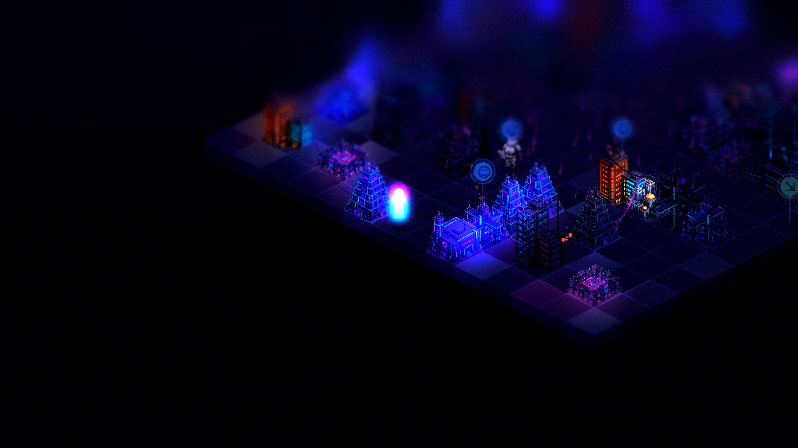
- **Shift Report**: the results screen shows who carried the fight, with an MVP and a title they earned ("Closing Time", "Designated Driver", "Human Sandbag"…). 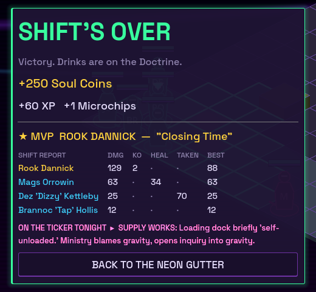
- **News Reacts**: the Doctrine news desk spins every battle onto the ticker and the living screens. Wins become "scheduled maintenance", losses become gloating, bosses go "on extended leave", MVPs get wanted posters, and sometimes Kade Halloway's Veil feed chimes in. Lines live in `data/news_reacts.json`, so add your own.
- **Quest toasts**: NEW JOB / NEW LEAD / progress / JOB DONE cards on every screen. 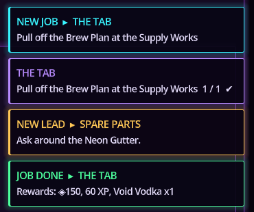
- **STREETS** tab in the hub: the in-game way out of the bar onto the street maps.
- **Settings** (hub → SAVE / QUIT): fast battles (1.6×), reduce motion, barks, sound effects + volume, auto Sync Additions. They're saved between sessions.
- **Charged spells are marked on the map**: violet outline for enemy casts, cyan for yours. The AI now steps out of them. 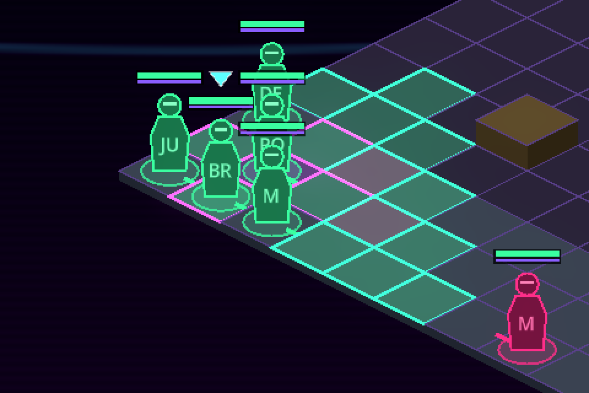

## Visual fixes (improvements only, before → after)
- Units no longer get darker and warmer after their first status effect (a shader bug). 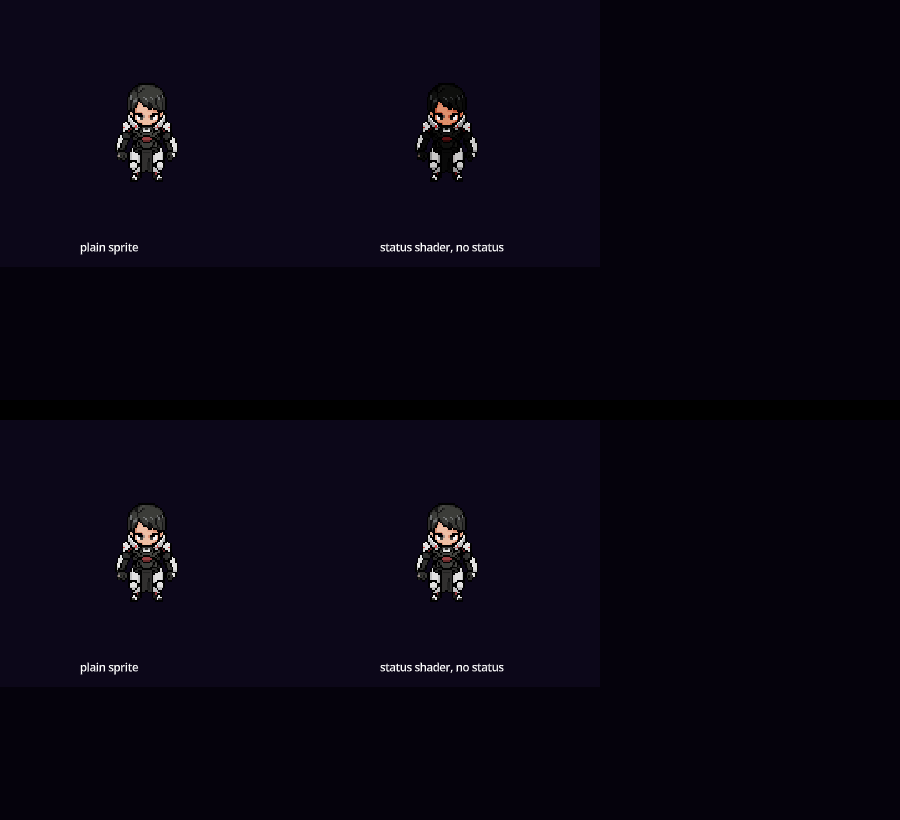
- The streets get the same neon glow as battles (left before, right after). 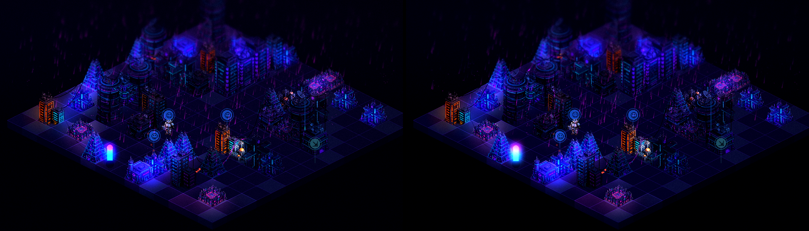

## Fixed from Grok's list
Hit-stop/slow-mo now has one owner of game speed. The explore backdrop is no longer a 60,000-pixel rectangle. Mission AI overrides and guest statuses apply. Steal abilities pay out at the end of the battle. Loot anchors and street loot count for find-loot quests. Rumours can wait for story flags (`required_flag`, `hidden_flag`). Foreman Grisk is a proper boss. The vault relay no longer plays "shield down" twice. Painted tiles survive into battle exactly (a bridge over water stays walkable). Passives are editable in the Forge. Long PixelLab folder names are shortened so Windows can pull them.

Already fine, no change needed: hidden, blinded, focused, berserk, identity loss and dualcast all work (Grok's note was out of date).

## Your call (not changed)
1. **Enemies use both action points?** The AI takes one action a turn while your units take two. Giving them both makes every fight much harder.
2. **Sleep breaks when hit?** FFT does it; ours doesn't.
3. **Mission difficulty slider:** `difficulty_modifier` exists but nothing reads it. Should it scale enemy HP, damage, levels, or the AI?
4. **Losing a street battle:** back to the map at 1 HP, game over and reload, or back to the hub (current behavior)?
5. **Knocked-out crew get XP?** Right now they do.
6. **Anchor-only turns:** using a terminal without attacking costs less turn time. Intended discount?
7. **Facings:** cardinal in code vs. diagonal in art and the roadmap.
8. **Fog sheet:** it has the same texture-squared quirk as the status shader. Fixing it would make all fog about twice as thick, so I left it.
