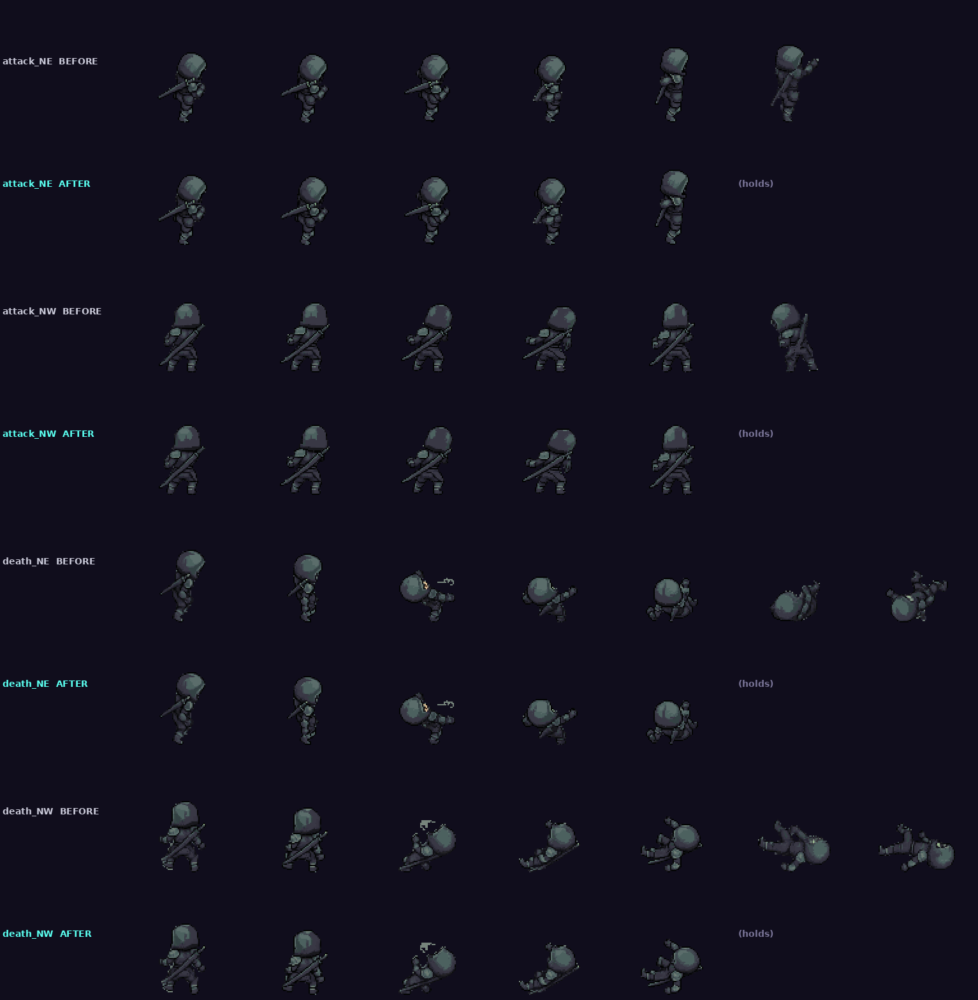
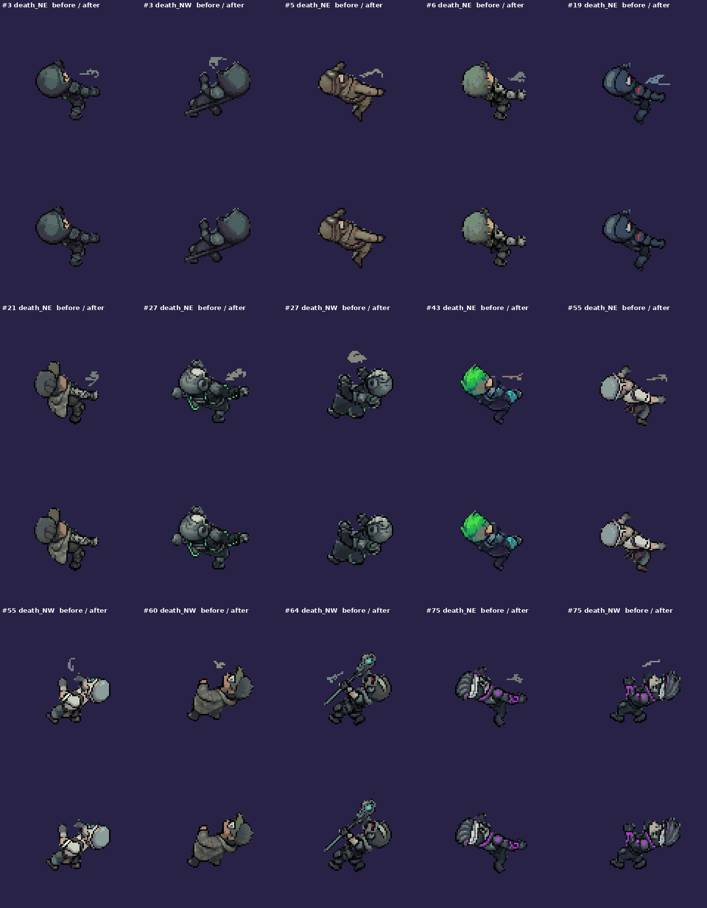
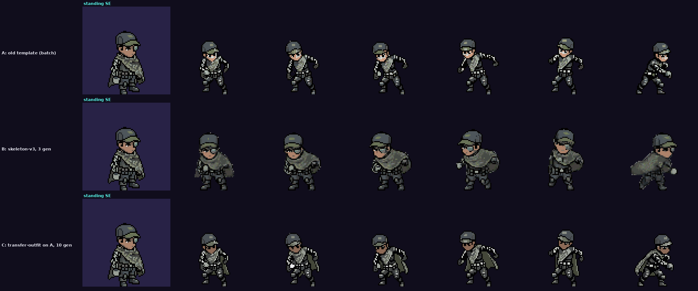
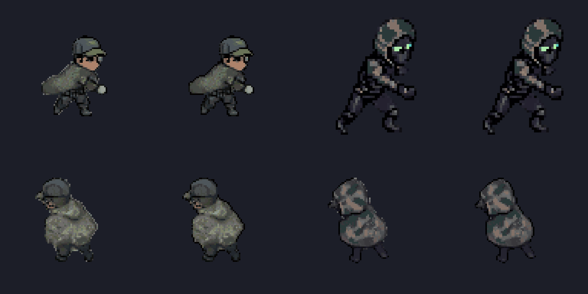
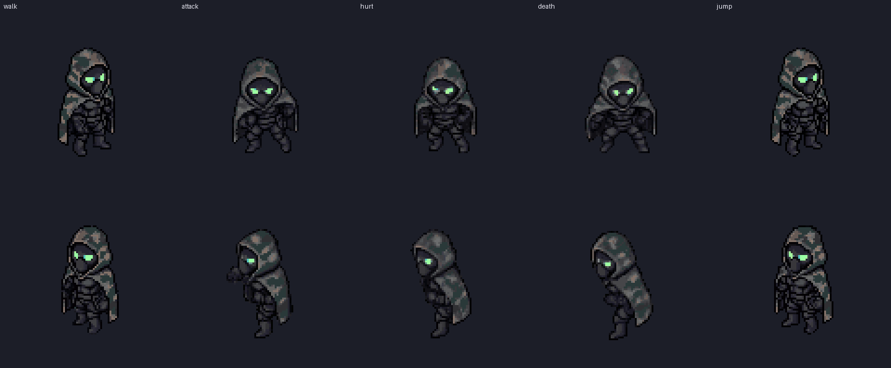

# Cast batch audit (2026-11-07)

Every frame of the 25 characters checked against their own standing poses. Sheets: one row per animation and facing, standing pose on the left.

## What broke, by cause
1. **Front facings of attack, hurt, death and jump (SE, SW; template mode).** PixelLab redraws the body on its mannequin, so outer layers and held items drop out: cloaks and ponchos (#4, #21, #60, #132), long coats and robes (#9, #43, #54), capes, books and swords (#24, #3), staffs (#62, #64), helmets and faces (#127, #62, #64). Walk in the same mode mostly held up.
2. **Back facings of attack, hurt and death (NE, NW; skeleton-v3).** The outfit stays, but heads swell into blobs mid-motion, and the last 1-2 frames of attack and death smear into mush on nearly every character.
3. **Hurt SW** often changes colours (white gloves or patches on #3, #29, #64).
4. **One-offs:** a pink blob in #71 jump SE frame 2, a pink mouth in #4 death SE.
5. **Game bug:** skeleton-v3 frames are 96 px while the standing poses are 60 px, so back facings were drawn off the unit's spot. Fixed in cbcac693 ("skeleton-mode takes stand on their feet").

## Usable as is
- **Walk, all 4 facings:** good for most. Not for the cloak / poncho characters on SE and SW (#4, #21, #60, #132).
- **Jump NE / NW:** good for nearly all.
- **Death SE / SW** and **hurt SE:** fine for characters without long clothing or held items (#5, #6, #19, #29, #71, #74, #75, #78, #79, #97).

## Per character
| # | Verdict | Main problems |
|---|---|---|
| 3 | mixed | sword gone in front attack / hurt; back death melts |
| 4 | bad | camo cloak gone in every front facing; back attack / hurt / death are blobs |
| 5 | fair | coat thinner in front attack; back death melts |
| 6 | fair | back hurt / death heads swell |
| 9 | mixed | robe gone in front attack / hurt / death; bow kept on the back |
| 19 | good | back death last frames smear |
| 21 | bad | poncho gone in front; back attack / hurt are blobs |
| 24 | mixed | cape, book and sword gone in front attack / hurt / death |
| 25 | fair | skull face changes in hurt SE; back hurt / death smear |
| 27 | fair | robe gone in front hurt; back death smears |
| 29 | fair | hurt SW colour patches; back death smears |
| 43 | mixed | coat and back weapon gone in front attack / hurt |
| 54 | mixed | coat gone in front attack |
| 55 | fair | back death smears |
| 60 | bad | poncho gone in front; back hurt NW is a blob |
| 62 | mixed | staff and face gone in front attack / hurt |
| 64 | mixed | staff and cyborg eye gone in front attack / hurt / death / jump |
| 71 | good | one pink blob frame in jump SE |
| 74 | good | trousers turn pink in attack SE |
| 75 | good | back death last frames smear |
| 78 | good | back death last frames smear |
| 79 | good | back hurt / death heads blob |
| 97 | fair | back attack / hurt / death blobby |
| 127 | mixed | helmet shape gone in front attack / hurt |
| 132 | bad | same problems as #4 (camo cloak) |

## Free fixes before any new spending
- Drop the smeared final frames of back attack and death (hold the last clean frame) with a per-animation frame range in `pixellab.json`.
- Use the older kept takes where they're better for a facing.

## Fixes done (free, 2026-11-07)
- Back-facing attack and death end on their last clean frame (`keep_frames` in each `pixellab.json`). Tradeoff: back attacks stop before full reach, and some back deaths end mid-fall rather than flat.
- #5 back hurt and jump use the older template takes (steadier head size). For #4 and the kit copies of #3 / #5 the older takes were worse (mannequin, cloak lost), so they stay unused.

- Frame 3 of the back deaths on 11 characters had a grey whoosh mark floating beside the body (PixelLab's death template draws it). `clean_frames` keeps only the body's shape on those frames.

## Quality test: #21 attack SE (13 generations, ceiling 40)
| Method | Cost | Poncho | Skin | Cap / goggles | Striped sleeve | Size vs standing (58 px) | Verdict |
|---|---|---|---|---|---|---|---|
| A: template (the batch) | (spent) | lost | lighter | kept | kept | 48-52 px, shrunken | fail |
| B: skeleton-v3 on the front facing | 3 | **kept, camo pattern too** | right | kept | fainter | 53-57 px, right for a crouch | **pass**, last frame smears (trim it) |
| C: transfer-outfit onto A | 10 | thin dark drape, no camo | right | kept | kept | 48-52 px (inherits A) | fail |

B is in PixelLab next to the other takes, not pinned in the game yet. C's frames are kept in `assets/kit/pool_021/`.

## Redo plan (method B, measured 3 a facing; front facings only)
Walks, back jumps and anything the audit called usable are left out. Characters #6, #19, #55, #75, #78, #79 and #97 need nothing on the front (their remaining faults are back-facing head blobs, which B itself causes).

| # | Redo (SE + SW unless noted) | Facings | Est. |
|---|---|---|---|
| 21 | walk, hurt, death, jump; attack SW (SE done) | 9 | 27 |
| 4 | walk, attack, hurt, death, jump | 10 | 30 |
| 132 | walk, attack, hurt, death, jump | 10 | 30 |
| 60 | walk, attack, hurt, death, jump | 10 | 30 |
| 64 | attack, hurt, death, jump | 8 | 24 |
| 9 | attack, hurt, death | 6 | 18 |
| 24 | attack, hurt, death | 6 | 18 |
| 3 | attack, hurt | 4 | 12 |
| 43 | attack, hurt | 4 | 12 |
| 62 | attack, hurt | 4 | 12 |
| 127 | attack, hurt | 4 | 12 |
| 5 | attack | 2 | 6 |
| 54 | attack | 2 | 6 |
| 27 | hurt | 2 | 6 |
| 25 | hurt SE (mirrored) | 1 | 3 |
| 29 | hurt SW | 1 | 3 |
| 71 | jump SE | 1 | 3 |
| 74 | attack SE | 1 | 3 |
| **Total** | | **85** | **~255** (2-4 a facing: 170-340) |

Only attack has been tested in this mode on a front facing. Hurt and death may get the same head swelling the back facings showed, so the first approved group should include them.

## Outline restore (free, 2026-11-07)
Soft frames lose their dark outline. `outline` in each `pixellab.json` repaints light edge pixels in the standing pose's outline colour on attack, hurt, death, jump and walk. It sharpens the silhouette; it doesn't bring back lost camo or shapes.

## Redo: #4 done (2026-11-09)
All 10 front facings (walk, attack, hurt, death, jump; SE and SW) in skeleton-v3 with `tools/pixellab/redo_facing.py`, 3 generations each, 30 in all. The cloak and glowing eyes hold on every take; the camo fades on some hurt and death frames (touch-up list). Verdicts per take in `tools/pixellab/pool_runs.json` redo_log. Boots that lose their bottom outline in crouches get a one-pixel sole (`outline.sole`).

