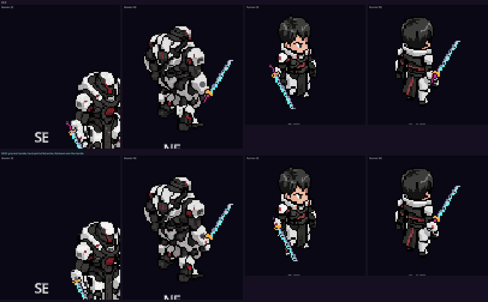
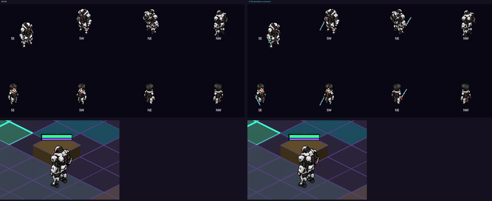

# Modular characters: gear that shows on units

Goal: equipped weapons and armour, and class changes, show on the unit in every facing.

## How it fits together
| Piece | Where | What it does |
|---|---|---|
| Rig (anchor points) | `<body folder>/rig.json` | Where the hands and head are, per animation frame. `z` says whether a held piece goes in front of or behind the body |
| Attach art set | an item's `wear_path` folder: `attach.json` + `<FACING>.png` | The weapon or helmet picture and the pixel that's held (the grip). A missing facing borrows its mirror |
| Layer gear | an item's `wear_path`, or a job's `outfit_path`, in PixelMatrix layout (`<anim>/<FACING>_<Limb>.png`) | Worn layers on base bodies, stacked per limb in each facing's order and composited once |
| Job look | `outfit_path`, `palette_swap` on the job (`data/classes.json`) | The job's outfit layer and recolour (`{"#rrggbb": "#rrggbb"}`) |
| Runtime | `src/vfx/gear_attach.gd` (GearAttach), `Unit.refresh_look()` | Follows the body sprite every frame: animation, frame, facing, mirror. Presentation only |
| Rig estimator | `src/vfx/rig_estimate.gd`, `tools/rig/make_rig.gd` | Writes a first-guess `rig.json` from the body's own frames. Local and free |
| PixelLab pilot | `tools/pixellab/pilot.py` | Base body, skeleton-template walk in 8 directions, armour layer, weapon. `plan` shows the cost; nothing is spent without `--go` |

A `wear_path` folder of either kind works: the game tells them apart by layout. An item with no `wear_path` shows nothing, so the current look stays as it is until art is assigned.

## rig.json
```json
{"points": {
  "hand_r": {"facing": {"SE": [40, 92, 1]}, "anims": {"attack_SE": [[40, 92, 1], [44, 88, 1]]}},
  "hand_l": {...}, "head": {...}}}
```
`x, y` are pixels in the animation's cell. `z` > 0 means in front of the body, < 0 behind. An optional 4th number is the forearm angle, used only by art with `"rotate": true`. Lookup order: this frame, the anim's last frame, the facing's still pose, then the mirrored facing.

Make one: `godot --headless --path . -s res://tools/rig/make_rig.gd -- res://assets/units/<name>` (add `--force` to redo it). Hand-edit any pose that reads wrong.

## attach.json
```json
{"point": "hand_r", "grip": [24, 24], "grips": {"NE": [24, 24]}, "z": {"NE": -1}, "rotate": false, "order": 0}
```
`point` is the rig point to pin to (`hand_r`, `hand_l`, `head`). `grip` is the middle of the handle. `z` overrides the rig's side for one facing. `order` stacks several pieces on the same side. `cover` redraws the body's own pixels within that many pixels of the hand over a piece held in front, so the fist closes over the handle.





## Notes for the 50 existing characters
- They stay whole sprites. Weapons and helmets attach through the rig.
- PixelLab's current ZIP export says `metadata.json` carries skeleton keypoints for every frame. The repo's older exports (3.1) don't. Re-downloading a saved character's ZIP (`GET /characters/{id}/zip`) should give exact hand and head points at no credit cost; `/estimate-skeleton` costs 0.1 generation per frame if not. Until then the silhouette estimator fills in.
- Battle facings are still the four diagonals (the facing question is open with Brian). Rigs and art sets name all eight facings, so nothing changes if the answer is eight.

## Status (2026-11-05)
- Built: rig lookup, attach art, front/back per facing, mirroring, the estimator, item `wear_path`, job `outfit_path` and `palette_swap`, PixelMatrix palette swap, test `test_gear_attach`.
- Pilot weapon: `assets/gear/weapons/pilot_blade` (placeholder art drawn by `tools/gear/make_pilot_weapon.py`). No game item uses it yet: that waits for Brian's before/after.
- PixelLab pilot: base body A + walk in 8 directions done (`assets/units/base_body_a`), 10 generations. Armour and weapon steps next.
